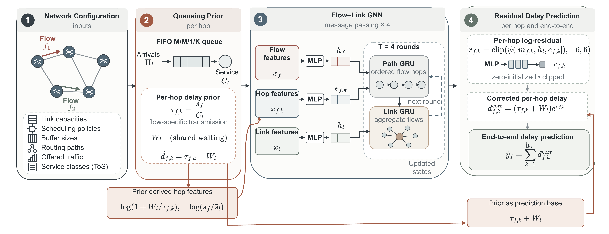
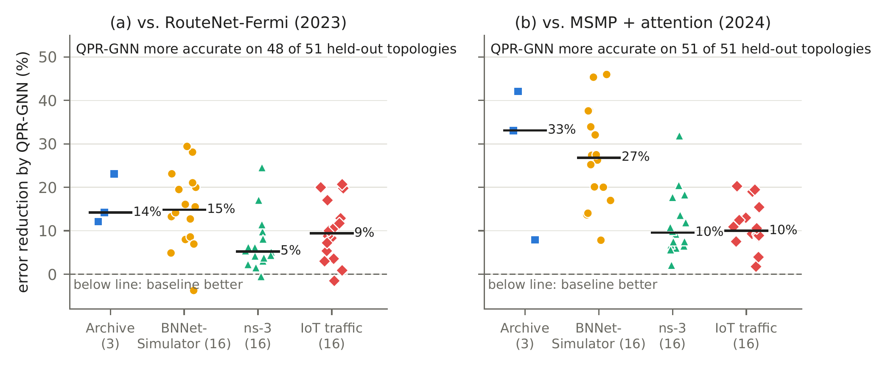
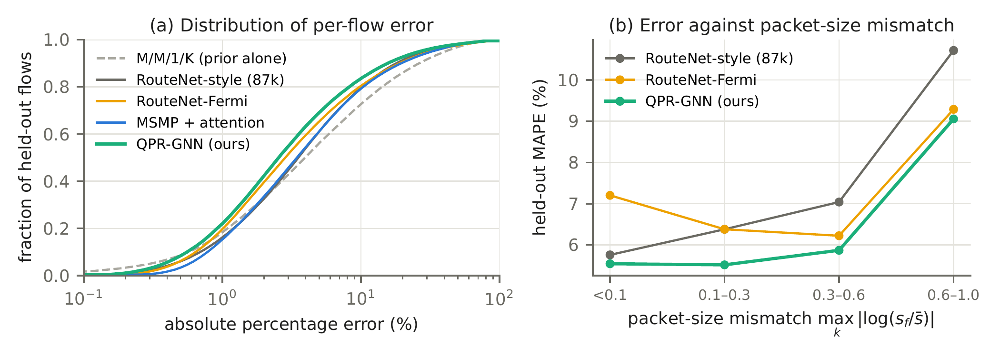
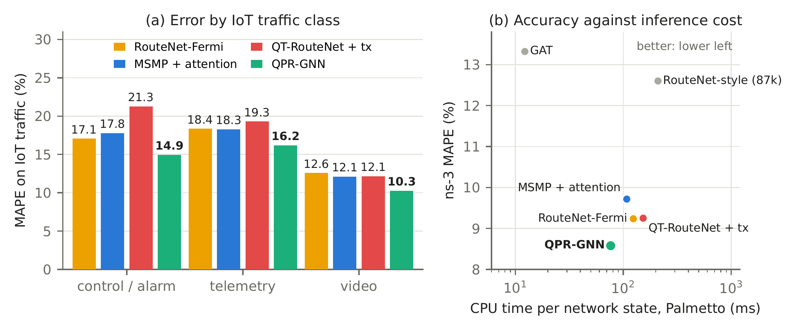

# QPR-GNN

Queueing-prior residual graph neural network for per-flow delay prediction in IoT backhaul networks.

## Contents

- `qprgnn/`: model, queueing prior, data parsing, baselines
- `scripts/`: data preparation, training, evaluation, tables
- `figures/`: figure scripts and the manuscript figures
- `ns3/`: ns-3 scenario for the simulator studies
- `data/raw/`: simulation outputs (see Data)
- `tests/`: unit tests
- `results/`: evaluation outputs (CSV, JSON, text summaries)

## Setup

```
pip install -r requirements.txt
scripts/setup_data.sh
```

## Data

`data/raw/` contains the packet-level simulation outputs used in the manuscript:

- `sim_results.zip`: BNNetSimulator, 16 Topology Zoo networks
- `ns3_results.zip`: ns-3, the same 16 networks
- `iot_results.zip`: ns-3 with IoT traffic (control/alarm, telemetry, video), the same 16 networks
- `topology_zoo_graphml.tar.gz`: Topology Zoo graphs

The simulator inputs are regenerated deterministically by `scripts/setup_data.sh`.

The RouteNet-Fermi trace archive (GEANT, Abilene, Nobel-EU, Germany50) is public and distributed by its authors
through the [RouteNet-Fermi repository](https://github.com/BNN-UPC/RouteNet-Fermi). Place it at
`data/raw/real_traces.zip` before running the setup; without it, the setup prepares the simulator datasets only.

## Manuscript results

| Manuscript item | Source |
|---|---|
| Table I (datasets) | `scripts/dataset_stats.py`, `results/analysis/dataset_stats.txt` |
| Tables II and III | `scripts/tables_v3.py`, `results/analysis/tables_v3.txt` |
| Table IV (readout base) | `scripts/eval_prior_ablation.py`, `results/analysis/prior_ablation_v3.txt` |
| Table V (violation detection) | `scripts/iot_decision.py`, `results/analysis/iot_decision_v3.txt` |
| Table VI (inference cost) | `scripts/efficiency.py`, `results/analysis/efficiency_v3.txt` |
| Training budget | `scripts/budget_summary.py`, `results/analysis/budget.txt` |
| Design selection | `scripts/selection_check.py`, `scripts/v3_selection.py`, `results/analysis/selection.txt`, `results/analysis/v3_selection.txt` |
| Numbers in the text | `scripts/paper_numbers.py`, `results/analysis/paper_numbers.txt` |
| Figures 2 to 4 | `figures/plot_headline.py`, `figures/plot_cdf_mismatch.py`, `figures/plot_iot_speed.py` |

```
python3 -I scripts/tables_v3.py
python3 -I scripts/paper_numbers.py
```

## Figures

The manuscript figures are in `figures/` as PDF (as used in the manuscript) and PNG.

**Fig. 1.** Architecture of QPR-GNN.



**Fig. 2.** Error reduction of QPR-GNN relative to RouteNet-Fermi and MSMP on every held-out topology.



**Fig. 3.** (a) Distribution of per-flow error. (b) Error against packet-size mismatch.



**Fig. 4.** (a) Error by IoT traffic class. (b) Accuracy against inference cost.


